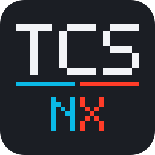

# LEGO Star Wars: The Complete Saga for Nintendo Switch

An unofficial native port of the Xbox 360 version of *LEGO Star Wars: The Complete Saga* to the Nintendo Switch, as
homebrew. It is not an emulator. The game's PowerPC code is recompiled ahead of time to ARM64 with XenonRecomp, and a
runtime written for the Switch provides the Xbox 360 services:
- memory and threads;
- files and saves;
- input and audio;
- graphics, through OpenGL on Mesa/Nouveau.

**This repository is source only.** It contains no game files and no ready-made download. To build and play it you
need your own copy of the Xbox 360 game.

**State:**
- Story levels play with native saves, two-player co-op and full audio.
- Tested on a real Switch in Episode I (Gungan route) and Episode IV (Blockade Runner to Mos Eisley); one co-op
  session lasted 93 minutes without a crash.
- Other chapters have not been checked yet. Reports are welcome.

## Requirements

- **A Switch that runs homebrew** (custom firmware such as Atmosphère). [sphaira](https://github.com/ITotalJustice/sphaira)
  is recommended to make a HOME-menu forwarder that gives the game all four CPU cores.
- **About 6 GB free on the SD card:** the game's data (about 5.8 GB) plus the app.
- **Your own copy of the Xbox 360 game:** the USA/Europe Rev 1 multilingual release. Its checksums are in
  [`provenance/expected-inputs.json`](provenance/expected-inputs.json).
- **A PC to build on.** Tested on Windows with devkitPro (devkitA64, libnx), CMake and Python 3. The full list is in
  [docs/BUILDING.md](docs/BUILDING.md).

## Building and installing

The build makes Switch code out of your copy of the game, so it cannot be shipped ready-made. In outline:

1. **Get the dependencies** at the pinned versions ([`provenance/dependencies.json`](provenance/dependencies.json)):
   XenonRecomp, Xenia Canary, SPIRV-Cross, SIMDe.
2. **Generate the game code** from your `default.xex` with XenonRecomp, and apply the port's patch to the output.
3. **Build Mesa for the Switch** with the port's changes: `source/switch/tools/build_mesa.sh`.
4. **Build the NRO** with CMake from `source/switch`. The current recipe (guest memory without `volatile`, plus an
   optional profile-guided build) is in "The current build" in [docs/BUILDING.md](docs/BUILDING.md).
5. **Prepare the runtime data** from your copy: `game.DAT`, `game1.DAT`, `Movies/`, `audio/`, `image.bin`,
   `pristine.bin` and `xex_header.bin` ([docs/BUILDING.md](docs/BUILDING.md), "Game data needed at runtime").
6. **Copy to the SD card:** the NRO to `sdmc:/switch/lswtcs/lswtcs.nro`, the data and a settings profile to
   `sdmc:/lswtcs/`.

The SD layout is in [docs/playing.md](docs/playing.md).

## Playing: controls and settings

**Settings profiles.** `sdmc:/lswtcs/env.txt` sets how the game runs. Use one of the two profiles:
- [`profiles/player.env`](profiles/player.env) **to play:** tuned settings, diagnostics off.
- [`profiles/hardware-ab.env`](profiles/hardware-ab.env) **to test and bring logs:** the same settings plus the
  diagnostics.

**Controls:**
- The controller maps to the Xbox 360 pad: Plus is Start, Minus is Back, L/R and ZL/ZR are the bumpers and triggers.
- Face buttons follow the labels in menus and the 360 positions in play. L + R + Minus switches the layout.
- A second controller joins with Plus. L + R + Plus opens the controller screen.

**Four cores.** From the Homebrew Menu the game gets three CPU cores. A sphaira forwarder with *CPU Cores: 4* gives it
the fourth, which the port uses for background work such as preparing shaders. One forwarder is enough.

**Uninstalling.** Deleting the forwarder removes only the shortcut. Saves are kept in the console's save storage under
the port's own ID, apart from the forwarder and the NRO.

[docs/playing.md](docs/playing.md) has the details: every control, the profiles, forwarders, saves, what
uninstalling removes, and how to send logs.

## How to collaborate

- **Test and bring logs:** play with the testing profile and send the session's folder from `sdmc:/lswtcs/logs/`
  ([docs/playing.md](docs/playing.md), "Testing").
- **Change the code:** read [CONTRIBUTING.md](CONTRIBUTING.md). Then the end of [docs/progress-log.md](docs/progress-log.md)
  has the newest state, and [docs/ARCHITECTURE.md](docs/ARCHITECTURE.md) the code map.
- **Coding assistants** follow [AGENTS.md](AGENTS.md).

Everything below is the technical side.

## Known issues

- **Heavy scenes on handheld run at about 30 FPS.** The GPU is the limit there (see Performance).
- **A level's first visit stutters briefly** while its shaders are prepared. The game keeps a list of them on the SD
  card, so later visits and the next boot prepare them in advance. For the first two minutes after boot, the game also
  prepares the saved list in the background.
- **The movie that plays when the title screen is left idle** can show corruption and hang at its end. Avoid leaving
  the title screen idle. Tracked in [docs/history/2026-11-01-handoff/ISSUES.md](docs/history/2026-11-01-handoff/ISSUES.md),
  issue 3.
- **A rare crash inside the GPU driver** (a buffer with no device during a command flush). It has not been seen in
  the recent sessions, including a 93-minute one, but its cause is not fixed.
- **Short audio dropouts** can still happen in the heaviest scenes, about 1-2 % of a session.
- **A block of binary bytes** sometimes appears in `stdout.log`. It is harmless to play, and its cause is open.

## Performance

Measured on a real Switch, on the Gungan route (hub, Episode I chapter 2):

| | Handheld | Docked |
| --- | --- | --- |
| Average FPS, whole session | about 42 | about 49 |
| Heavy combat frames (1300+ draws) | about 30 FPS | about 31 FPS |
| What limits heavy frames | the GPU | the chain from game frame to GPU |
| Render stalls of 250 ms or more, per 3-minute session | 0-0.65 s (was 2.9 s) | not measured |

- **GPU clock.** The handheld GPU runs at 460.8 MHz, Nintendo's own handheld configuration `0x92220008`, not an
  overclock. `LSWTCS_GPUBOOST=0` keeps 307.2 MHz.
- **What made the game code faster:**
  - guest memory without `volatile`;
  - profile-guided optimisation.

  Together they cut the main thread's CPU per recompiled call from 157 to about 127 ns.
- **Shader preparation:**
  - Mesa now reuses the translation of a shader stage it has already compiled. This cut the cost per program by about
    45 %; checked word for word on hardware.
  - With four cores, a second compiler on the fourth core handles the saved list.

Every number has its session and evidence in [docs/progress-log.md](docs/progress-log.md). What could come next is in
the last section of [docs/reviews/CPU_ROADMAP.md](docs/reviews/CPU_ROADMAP.md).

## Credits and licence

- **The port:** [KingDariusStim](https://github.com/KingDariusStim), author of
  [LSWTCS-360-to-Switch-Port](https://github.com/KingDariusStim/LSWTCS-360-to-Switch-Port), the original port this
  repository continues.
- **Performance work, hardware testing and documentation since November 2026:** Gabriel B
  ([g-brrzzn](https://github.com/g-brrzzn)), with Claude (Anthropic) as a coding assistant.
- **Built on:**
  - [XenonRecomp](https://github.com/hedge-dev/XenonRecomp);
  - [Xenia Canary](https://github.com/xenia-canary/xenia-canary);
  - Mesa and devkitPro's Switch port of it;
  - libnx and devkitPro;
  - SPIRV-Cross, SIMDe, FFmpeg, xxHash and rpmalloc.

  Their licences and notices are listed in [THIRD_PARTY_NOTICES.md](THIRD_PARTY_NOTICES.md).
- **Related ports:** some techniques were learned from bo2-360-nx and rr6-nx (GPL-3.0). No code was copied from them so far.

**Licence.** The port's code is under the [GNU GPL 3.0](LICENSE), the usual licence for these ports. The original port
was published under CC BY-NC-SA 4.0 (kept in [`provenance/`](provenance/ORIGINAL_LICENSE-CC-BY-NC-SA-4.0.txt)); its
author's confirmation of the change is pending. The components keep their own licences
([THIRD_PARTY_NOTICES.md](THIRD_PARTY_NOTICES.md)).

**Disclaimer.** This is a fan project, not affiliated with or endorsed by the LEGO Group, Lucasfilm, TT Games,
Microsoft or Nintendo. *LEGO Star Wars: The Complete Saga* and its content belong to their owners. The repository
contains none of the game's data. Use your own legally obtained copy.

And may the Force be with you.
