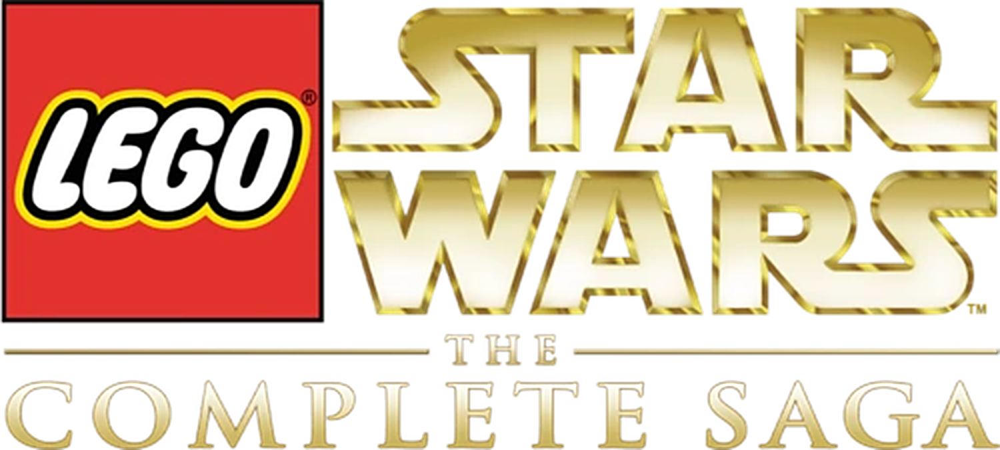

<p align="center">
  
</p>

<h1 align="center">LEGO Star Wars: The Complete Saga for Nintendo Switch</h1>

Play the Xbox 360 version of *LEGO Star Wars: The Complete Saga* on your Nintendo Switch, as homebrew: the story,
two-player co-op and saves. It is not an emulator. The game's own code was converted to run directly on the Switch's
processor, so it runs as a native app.

Under the hood: the game's PowerPC code is recompiled ahead of time to ARM64 with XenonRecomp, and a runtime written
for the Switch provides the Xbox 360's services (memory, threads, files, saves, input, audio, and graphics through
OpenGL on Mesa/Nouveau).

## Requirements

- **A Switch that runs homebrew** (custom firmware such as Atmosphère), with
  [sphaira](https://github.com/ITotalJustice/sphaira) to make a HOME-menu forwarder.
- **About 6 GB free on the SD card:** the game's data (about 5.8 GB) plus the app.
- **Your own copy of the Xbox 360 game**, this exact release:
  - *LEGO Star Wars: The Complete Saga*, Xbox 360, **USA/Europe**, **Rev 1** (version 1.1), one disc, region free;
  - title ID **4C4107D7**, media ID **5E486FF7** (Xbox 360 ISO tools and game databases show both).

  The game checks your `default.xex` when it starts and tells you on screen if it is another version. Checksums for
  developers: [`provenance/expected-inputs.json`](provenance/expected-inputs.json).

## How to install

`sdmc:/` below is the root of your SD card.

1. **Download the app:** `lswtcs-vX.Y.Z.zip` from the
   [latest release](https://github.com/lswtcs-nx/lswtcs-nx/releases/latest), and extract it to the root of your SD
   card. It puts the app at `sdmc:/switch/lswtcs/lswtcs.nro` and makes the `sdmc:/lswtcs/` folder.
2. **Copy the game's files** to `sdmc:/lswtcs/`: `default.xex`, `game.DAT`, `game1.DAT`, `Movies/` and `audio/`.
   They are at the root of your disc. If you have a backup of your disc as an ISO file, see
   [Taking the files from an ISO](#taking-the-files-from-an-iso). The game checks them at start and names any file
   that is missing or from another version.
3. **Make a forwarder** in sphaira, so the game gets all four CPU cores: in sphaira's list of homebrew apps,
   highlight *LEGO Star Wars: The Complete Saga*, press **X**, choose **Install Forwarder**, set **CPU Cores** to
   **4** and **Address Space** to **39-bit**, then choose **Create Forwarder**.
4. **Start the game** from its new icon on the HOME menu.

The game also starts from the Homebrew Menu without a forwarder, but there it gets only three CPU cores and stutters
more in its first minutes, while it prepares shaders.

The settings for play are built in, so no settings file is needed. The zip also puts `env-testing.txt` in
`sdmc:/lswtcs/`: it turns on logs when you want to report a problem (see [Reporting a problem](#reporting-a-problem)).

The finished SD card:

```text
sdmc:/
  switch/lswtcs/lswtcs.nro
  lswtcs/
    default.xex  game.DAT  game1.DAT  Movies/  audio/
    env-testing.txt
```

**Updating:** download the new release and replace `sdmc:/switch/lswtcs/lswtcs.nro` with its `lswtcs.nro` (or
extract its zip again). The forwarder starts the new version without being made again, and the saves and game files
are kept. [CHANGELOG.md](CHANGELOG.md) lists what each version changes.

**Uninstalling:** deleting the forwarder removes only the shortcut. To remove the game, delete
`sdmc:/switch/lswtcs/` and `sdmc:/lswtcs/`. Saves stay in the console's save storage.

### Taking the files from an ISO

[extract-xiso](https://github.com/XboxDev/extract-xiso) unpacks Xbox 360 ISOs. On Windows:

1. Download `extract-xiso-Win64_Release.zip` from
   [extract-xiso's latest release](https://github.com/XboxDev/extract-xiso/releases/latest) and unzip it.
2. Put your ISO in the same folder as `extract-xiso.exe` and rename it to `game.iso`.
3. Click the folder's address bar in File Explorer, type `cmd` and press Enter. In the window that opens, type this
   and press Enter:
   ```
   extract-xiso -s -d game game.iso
   ```
   (`-s` skips the disc's system update folder, which the game does not need.)
4. A `game` folder appears next to the ISO. Copy `default.xex`, `game.DAT`, `game1.DAT`, `Movies` and `audio` from it to
   `sdmc:/lswtcs/`.

On macOS or Linux, use `extract-xiso_macOS.zip` or `extract-xiso_Linux.zip` from the same page, and run
`./extract-xiso -s -d game game.iso` in a terminal opened in that folder.

## Controls

The game shows Xbox 360 button icons. In menus, the buttons work as on the Switch: A confirms and B goes back. In
play they keep the Xbox 360 positions: the bottom button (B on the Switch) jumps, as A did on the 360.
- **Plus** pauses (the 360's Start), **Minus** is the 360's Back.
- **L / R** and **ZL / ZR** are the 360's bumpers and triggers.
- **L + R + Minus** switches how the face buttons are read: by position (as on the 360), by letter (as on the
  Switch), or both, as above.
- **Player 2:** press **Plus** on a second controller. **L + R + Plus** opens the Switch's controller screen.

[docs/playing.md](docs/playing.md) has every control, the testing profile, forwarders, saves, and how to send logs.

## Known issues

- **The movie that plays when the title screen is left idle** can show corruption and hang at its end. Avoid leaving
  the title screen idle.

The full list, with the technical detail for contributors, is in [docs/known-issues.md](docs/known-issues.md).

## Reporting a problem

The game can write detailed logs that show us what happened. To turn them on and send them:

1. **Turn the logs on:** rename `sdmc:/lswtcs/env-testing.txt` to `env.txt`. You can do it on the Switch, in sphaira's
   file browser, or on a PC. (On Windows, check the name does not end up as `env.txt.txt`.)
2. **Play** until the problem happens. When it does, hold **ZL + ZR and click the left stick**: it marks that moment in
   the log.
3. **Close the game** from the HOME menu.
4. **Zip the newest folder** in `sdmc:/lswtcs/logs/`. Ten minutes of play make a zip of about 4 MB; GitHub takes up
   to 25 MB, so short sessions are best.
5. **Open a [bug report](https://github.com/lswtcs-nx/lswtcs-nx/issues/new?template=bug_report.yml)**, fill in the form (handheld or docked, where in the game, what you saw or heard)
   and attach the zip.
6. **Turn the logs off:** rename `env.txt` back to `env-testing.txt`. The logs take about 120 MB of the card per hour.

Never send the game's files, saves or keys. `stdout.log` names the console user that loaded the save; remove that line
if you prefer. If your card has no `env-testing.txt` (installs before the release zip had it), save
[this file](https://github.com/lswtcs-nx/lswtcs-nx/raw/main/profiles/hardware-ab.env) as `sdmc:/lswtcs/env-testing.txt`.

## Performance

What the port does to run well on the Switch. Every change was measured on a real Switch; its session and evidence are
in [docs/progress-log.md](docs/progress-log.md).

**Game code (CPU)**
- Guest memory accessed without `volatile`, with `-fno-strict-aliasing` and compiler barriers only at guest sync
  instructions and loop headers.
- Profile-guided optimisation (GCC), with counts from a play session on an instrumented build.
- Guest addresses translated by one bit fold instead of a region-table load per access.
- Float compares without flag side effects, and argument registers kept in locals inside hot loops.
- Together these cut the main thread's CPU per recompiled call from 157 to 127 ns.

**Threads**
- The Xbox 360 GPU command stream (PM4) is walked on its own thread, off the guest's turn. GPU kicks hand the ring to
  it, and ring-space waits end at the walker's published position.
- XMA audio decoding and LZ2K decompression run on worker threads, beside the game, as the 360's hardware decoder does.
- The XAudio mixing work runs off the guest's turn, with a native mixer that matches the game's result bit for bit.
- Guest spinlocks are real compare-and-swap locks, and audio threads come first in the guest scheduler.
- With four cores, core 3 runs work no frame waits for: the log writer, XMA, file reads and a second shader compiler.
  A meter sends them back if core 3 gets busy.

**Rendering (OpenGL on Mesa/Nouveau)**
- The world is drawn once per frame, not once per EDRAM tile. Tile groups are merged, and resolves go straight into
  the stitched target.
- A draw's preparation is reused while no register changed, and the command walk skips guest pages unchanged for 8
  frames. Both keep a sampled check that turns them off at the first difference.
- Shader variants are specialised: alpha test, gamma, output bias, and fetch scale and LOD bias become constants.
  Fetch constants come from one block per draw.
- Mesa: unchanged constant-buffer binds are skipped, quads are drawn as indexed triangles instead of through a
  geometry shader, and 2x MSAA surfaces render at one sample per pixel.
- The handheld GPU runs at 460.8 MHz, Nintendo's official handheld configuration, not an overclock
  (`LSWTCS_GPUBOOST=0` keeps 307.2 MHz).

**Shaders and textures (stutter)**
- Every shader program the game used is saved on the SD card. Later boots prepare the list in the background, the
  current level's programs first.
- Shader translations are saved too (`sdmc:/lswtcs/glprogs2/xlate.bin`), so from the second session the hub's long
  first frames are gone; the first few loaded are re-translated and compared.
- Mesa reuses the nvc0 translation of an identical shader stage, which cut the cost per program by about 45 %; a
  sample is re-translated and compared.
- Two shader compilers; with four cores, the second takes only programs nothing is waiting for.
- New textures are made before the draw loop, decoded on three threads and uploaded as each one is ready. Texture
  storage is pooled, and uploads are staged from Mesa's GART suballocator.
- Large allocations come from newlib's allocator and small ones from rpmalloc, so freed large blocks merge.

**Next:** we are studying a move from OpenGL on Mesa to deko3d, the Switch's native graphics library, for a broader
gain.

## Building from source

Only needed to change the code: players use the release. The build makes Switch code out of your copy of the
game. Tested on Windows with devkitPro (devkitA64, libnx), CMake
and Python 3. In outline:

1. **Get the dependencies** at the pinned versions ([`provenance/dependencies.json`](provenance/dependencies.json)):
   XenonRecomp, Xenia Canary, SPIRV-Cross, SIMDe.
2. **Generate the game code** from your `default.xex` with XenonRecomp, and apply the port's patch to the output.
3. **Build Mesa for the Switch** with the port's changes: `source/switch/tools/build_mesa.sh`.
4. **Build the NRO** with CMake from `source/switch`. The current recipe (guest memory without `volatile`, plus an
   optional profile-guided build) is in "The current build" in [docs/BUILDING.md](docs/BUILDING.md).

The game's own files need no preparation: the app reads them from your disc's files on the SD card.

## How to collaborate

- **Test and bring logs:** see [Reporting a problem](#reporting-a-problem); [docs/playing.md](docs/playing.md) has the
  details.
- **Change the code:** read [CONTRIBUTING.md](CONTRIBUTING.md). Then the end of [docs/progress-log.md](docs/progress-log.md)
  has the newest state, and [docs/ARCHITECTURE.md](docs/ARCHITECTURE.md) the code map.
- **Coding assistants** follow [AGENTS.md](AGENTS.md).

## Credits

This port is currently developed by Tnes and Gabriel B ([g-brrzzn](https://github.com/g-brrzzn)). The components it
is built on, and their licences, are listed in [THIRD_PARTY_NOTICES.md](THIRD_PARTY_NOTICES.md).

**Disclaimer.** This is a fan project, not affiliated with or endorsed by the LEGO Group, Lucasfilm, TT Games,
Microsoft or Nintendo. *LEGO Star Wars: The Complete Saga*, its logo and its content belong to their owners. The
repository contains none of the game's data. Use your own legally obtained copy. Made by fans, for fans. Thanks for
playing.

<br>

<p align="center"><em>And may the Force be with you.</em></p>
