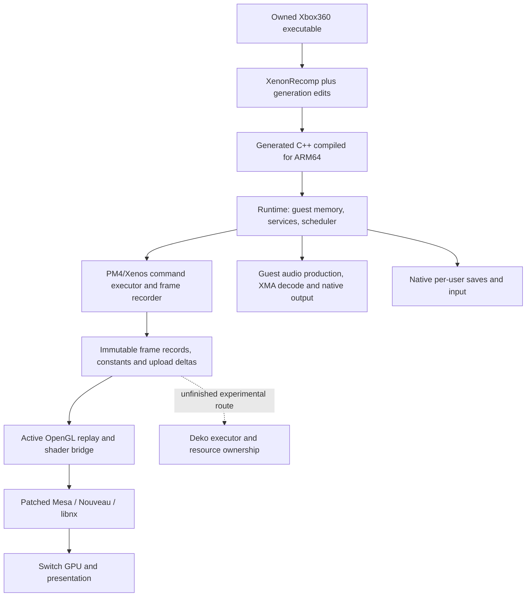

# Architecture and code map

## What kind of port this is

The input is the matching Xbox360 executable. XenonRecomp turns its PowerPC code
into C++ generated output, with port-specific hand edits. A host compiler builds
that output for the Switch's ARM64 CPU. This does not turn Xenos GPU commands or
Xbox kernel services into native Switch behavior automatically.

The maintained runtime implements the necessary kernel/XAM, memory, scheduling,
filesystem, input, audio and graphics boundaries. Original game data stays in the
owner-supplied files. This is neither a Wii version nor an Android APK wrapper.

## Source files to read

Paths in this table are relative to `../source/`.

| Boundary | Files |
| --- | --- |
| Guest execution, services, PM4 walk, scheduling | `LSWTCSRuntime/source/kernel_stubs.cpp`, `main.cpp`, `native_crt.cpp` |
| Guest address translation and ownership | `LSWTCSRuntime/include/lsw_guest_layout.h`, `lsw_guest_memory_access.h`, `lsw_guest_memory_ppc.h`, `lsw_guest_host_lock.h` |
| Immutable frame ABI and handoff | `LSWTCSRuntime/include/lsw_gpu_frame.h`, `lsw_gpu_swap.h`, `lsw_gpu_bridge.h` |
| OpenGL replay, uploads, tile composition and profiles | `switch/source/gl_backend.cpp`, `gl_rt.inc` |
| Xenos shader translation and constants | `switch/source/gl_bridge.cc`, `gl_geometry.cc`, `lsw_spirv_glsl.cc`, `switch/include/lsw_gl_shader.h` |
| Shared texture decode/interpretation | `LSWTCSRuntime/xenos_dxbc/lsw_gpu_texture.cc`, shared bridge headers |
| Platform services, exceptions and logs | `switch/source/platform_switch.cpp`, `win32_switch.cpp` |
| Native allocator and BO diagnostic | `switch/third_party/rpmalloc/rpmalloc_switch.c`, `switch/source/bo_check.cpp`, `switch/include/lsw_bo_check.h` |
| Audio | `switch/source/audio_switch.cpp`, runtime host/XMA code |
| Saves/menu identity | `switch/source/save_switch.cpp`, `LSWTCSRuntime/source/menu_switch.cpp`, save-platform/menu-policy headers |
| Experimental Deko | `switch/source/deko_backend.cpp`, `deko_resources.cpp`, `switch/include/lsw_deko_*.h/.inc` |
| Original desktop reference path | `LSWTCSRuntime/source/gpu_d3d12.cpp`, runtime DXBC bridge |

## Contracts that matter

**Guest memory is not a generic host pointer.** Address mapping, aliases, allocator
ownership, CPU writers and GPU-produced data have to agree. A later null pointer
or corrupt texture is not necessarily the first bad operation.

**Draw inputs must survive until replay.** Guest memory can change before
presentation, so constants and required uploads are recorded into a frame arena.
The build/present/render slots have an existing mutex-protected publication path.
Do not introduce a second frame/ownership model for a new renderer.

**Upload ranges are deltas.** `LswGpuRange` entries describe uploads needed for
residency, not every vertex span a draw may read. Equal upload lists do not prove
all GPU-resident geometry or guest-memory writers are equal. Preserve this
distinction when reviewing012 or earlier walk-time tile reuse.

**Predicated tiling is a semantic transformation.** The original game repeats a
draw sequence for EDRAM tiles, then resolves those rows. The GL planner can extend
the first tile and avoid equivalent later work. It must preserve differing draw
inputs, scissors, clear ordering, resolve destinations and dependencies.012 fixes
specific omissions in recorded identity; it does not establish complete resource
equivalence or identify the owner's screenshots.

**Native BO ownership is separate from guest memory.** Mesa/Nouveau BOs have
their own creation/ref/submission/free lifecycle. Internal pushbuffer references
can bypass an external wrapper. The temporary observer samples the actual
refcount; it does not reconstruct a complete reference ledger.

**Audio output and production are different deadlines.** Native output has its
own48000Hz servicing thread. Guest callbacks/production also depend on the guest
scheduler. The owner's apparent frame-locked jitter is an observation/hypothesis;
the production/admission/submit starvation boundary is not yet attributed.

## Shader preparation

The Mesa route translates guest shaders through Xenia SPIR-V generation and
SPIRV-Cross to GLSL, then Mesa compiles them for the GPU. Internal disk cache,
recorded GLSL program lists, session maps and optional application program binaries
are distinct mechanisms. Binary caching remains disabled after older problems;
do not enable it just because a warmup catalog exists.

Deko still needs executable GPU shaders. The prototype prepares DKSH through a
host/AOT compilation path. Removing on-console GLSL compilation does not remove
shader translation, variant coverage, cache identity or binding semantics.
